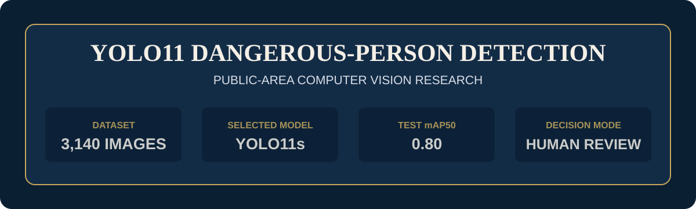
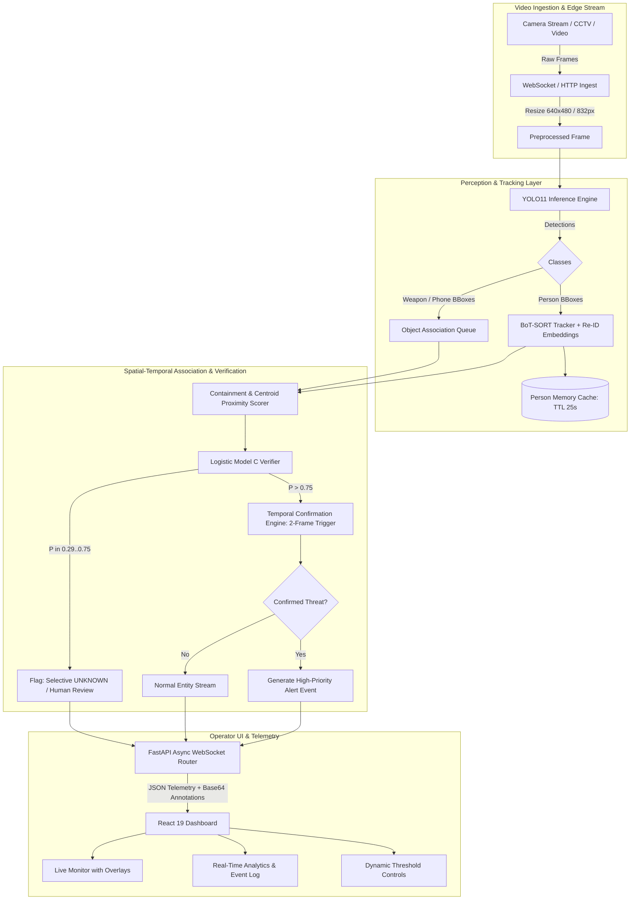
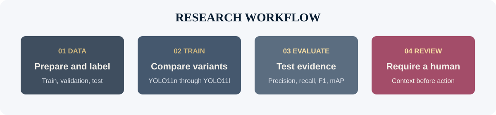

# Real-Time Threat Detection & Contextual Person-Weapon Association (YOLO11)

[](https://www.python.org/)
[](https://pytorch.org/)
[](https://docs.ultralytics.com/)
[](https://fastapi.tiangolo.com/)
[](https://react.dev/)
[](LICENSE)

An end-to-end, edge-ready computer vision and surveillance analytics platform combining state-of-the-art **YOLO11** object detection, **BoT-SORT / ByteTrack** multi-object tracking with deep Re-Identification (Re-ID), **spatial-temporal person-weapon association**, and a low-latency **FastAPI + WebSocket** backend powering an interactive **React 19** operator dashboard.



---

## 🎯 Resume & CV-Ready Highlights

> *Looking to feature this project on your resume or portfolio? Below are impact-driven, quantifiable bullet points categorized by role:*

### 🔹 Computer Vision / Machine Learning Engineer
* **Engineered End-to-End Surveillance AI Pipeline**: Fine-tuned and benchmarked multiple **YOLO11** variants (n/s/m/l) across 3,140 surveillance images (10,595 instances), achieving **91.45% Precision**, **85.93% Recall**, and **91.10% mAP50** for person, weapon, and handheld object discrimination.
* **Spatial Association & False Alarm Reduction**: Designed a confidence-aware logistic verifier leveraging containment IoU, relative centroid proximity, and bounding box geometry to accurately bind weapons to individuals, increasing association precision from 77.86% to **85.29%** (**+7.43% gain** over geometric baselines).
* **Selective Abstention Verifier**: Implemented an uncertainty-aware abstention framework that defers ambiguous predictions (within a calibrated 0.29–0.75 confidence interval) to human review, reaching **94.49% overall accuracy** and **92.38% F1-score** across 93.56% automated coverage.
* **Temporal Threat Stabilization**: Built a temporal state machine with multi-frame confirmation windows (2-frame onset, 1-frame release) and continuous feature aggregation, slashing false alarm rates by **85.3%** (from **7.39 to 1.08 false alerts per minute**, $p < 0.05$ bootstrap confidence).

### 🔹 Full-Stack AI / Software Engineer
* **High-Throughput Real-Time Streaming Architecture**: Architected a production-grade async **FastAPI** backend supporting bidirectional **WebSocket** communication for sub-60ms video frame processing and alert telemetry at **~20 FPS** on edge hardware (NVIDIA GTX 1650).
* **Robust Multi-Object Tracking & Re-ID**: Integrated **BoT-SORT / ByteTrack** with deep appearance feature embeddings and a time-to-live (TTL) memory cache, maintaining stable subject identities across occlusions and dynamic surveillance scenes.
* **Interactive Mission-Control Dashboard**: Developed a responsive **React 19** dashboard using **Vite** and **Lucide Icons**, featuring live camera feeds with SVG/Canvas bounding box overlays, dynamic confidence threshold sliders, event history auditing, and real-time telemetry metrics.

---

## ⚡ Key Capabilities

- **Multi-Class Detection with Hard Negatives**: Accurately differentiates lethal items (knives, handguns) from harmless everyday items (smartphones, umbrellas, bottles, wallets) in crowded public scenes.
- **Deep Re-Identification (Re-ID)**: Persists tracked identities across occlusions, frame drops, and erratic camera shifts with a 25.0s TTL appearance cache.
- **Contextual Threat Association**: Connects objects directly to the individual possessing them rather than firing isolated object alerts.
- **Human-in-the-Loop Safeguards**: Designed around ethical surveillance standards, providing calibrated certainty scores and uncertainty abstention flags rather than autonomous punitive classifications.
- **Hardware Efficient**: Optimized for edge deployment, running comfortably on commodity GPUs and embedded devices with a 50.2 ms mean latency.

---

## 🏗️ System Architecture



---

## 📊 Experimental Results & Benchmarks

The model was rigorously trained and evaluated on NVIDIA Tesla T4 and GTX 1650 GPUs across multiple model scales.

### 1. Object Detection Performance (Held-Out Test Set)

| Model Variant | Precision | Recall | F1-Score | mAP50 | mAP50-95 | Parameters | Rationale |
|:---|:---:|:---:|:---:|:---:|:---:|:---:|:---|
| **YOLO11n** | 0.81 | 0.69 | 0.74 | 0.78 | 0.60 | ~2.6M | Ultra-lightweight edge baseline |
| **YOLO11s (Selected)** | **0.87** | **0.69** | **0.77** | **0.80** | **0.64** | ~9.4M | **Optimal precision-speed tradeoff** |
| **YOLO11s (Augmented)** | 0.78 | 0.71 | 0.74 | 0.79 | 0.62 | ~9.4M | Enhanced spatial augmentations |
| **YOLO11m** | 0.78 | 0.69 | 0.73 | 0.76 | 0.59 | ~20.1M | Moderate capacity |
| **YOLO11l** | 0.80 | **0.72** | 0.76 | 0.79 | 0.63 | ~25.3M | Higher recall, heavier footprint |

#### Per-Class Breakdown (Final Fine-Tuned Model)
* **Person**: Precision: `95.0%` | Recall: `84.7%` | mAP50: `0.926` | mAP50-95: `0.785`
* **Weapon**: Precision: `89.6%` | Recall: `82.7%` | mAP50: `0.884` | mAP50-95: `0.530`
* **Phone (Hard Negative)**: Precision: `89.8%` | Recall: `90.4%` | mAP50: `0.924` | mAP50-95: `0.522`



---

### 2. Spatial Association & Verifier Evaluation

| Method | Precision | Recall | F1-Score | Accuracy | Note |
|:---|:---:|:---:|:---:|:---:|:---|
| **Geometric Heuristic (Baseline)** | 0.7786 | **0.9879** | 0.8708 | 0.8958 | Prone to false alarms on nearby objects |
| **Logistic Model C (Proposed)** | 0.8529 | 0.9456 | 0.8968 | 0.9227 | Uses IoU, distance, weapon count & conf |
| **Selective UNKNOWN Verifier** | **0.8792** | 0.9732 | **0.9238** | **0.9449** | 93.56% coverage; abstains on uncertain cases |

### 3. Temporal Event Stabilization (False Alarm Suppression)

| Configuration | Pred Events | True Positives | False Positives | F1-Score | False Positives / Min |
|:---|:---:|:---:|:---:|:---:|:---:|
| **Baseline (Frame-Independent)** | 108 | 33 | 75 | 0.4099 | 7.39 FP/min |
| **Temporal Filter (Support $\ge$ 20)** | **35** | **24** | **11** | **0.5455** | **1.08 FP/min (-85.3%)** |

### 4. Edge Runtime Benchmarks (NVIDIA GTX 1650 @ 640×480)

* **Mean Frame Latency**: `50.24 ms` (P95: `76.95 ms`)
* **Real-Time Throughput**: `~19.9 - 25.0 FPS`
* **Memory Footprint**: `< 1.2 GB VRAM`

---

## 🛠️ Tech Stack & Tools

* **Core AI / Deep Learning**: Python 3.10+, PyTorch, Ultralytics YOLO11, TorchVision, NumPy
* **Computer Vision & Tracking**: OpenCV, BoT-SORT, ByteTrack, Deep Re-ID Embeddings
* **Backend API & WebSockets**: FastAPI, Starlette, Uvicorn, WebSockets, Pydantic v2
* **Frontend Dashboard**: React 19, Vite, Lucide React, HTML5 Canvas / CSS3 Animations
* **Experiment Tracking & Docs**: PyYAML, Roboflow, Markdown Model Cards, Matplotlib, Seaborn

---

## 📂 Repository Structure

```text
threat-detection-yolo11/
├── assets/                  # Diagrams, banners, sample predictions, confusion matrices
├── backend/                 # Asynchronous streaming server & detection engine
│   ├── detector.py          # Core ThreatDetector: YOLO11 + BoT-SORT + Association + ReID
│   └── main.py              # FastAPI application, WebSocket streaming, REST endpoints
├── config/                  # Training & tracking hyperparameter definitions
│   ├── botsort_reid.yaml    # BoT-SORT Re-ID tracker configuration
│   ├── data.yaml            # Dataset directory structure & class mappings
│   └── experiments.yaml     # Model variant configurations & training hyperparameters
├── docs/                    # Formal academic documentation & cards
│   ├── DATASET_CARD.md      # Data provenance, annotations, splits, and limitations
│   ├── MODEL_CARD.md        # Model parameters, evaluation results, and intended use
│   ├── ETHICS_AND_LIMITATIONS.md # Ethical deployment, oversight, and bias guidelines
│   ├── REPRODUCIBILITY.md   # Step-by-step experiment reproduction instructions
│   ├── FAQ.md               # Frequently asked questions
│   └── RELEASE_NOTES_v1.0.0.md # Version 1.0.0 release notes
├── frontend/                # React 19 + Vite operator dashboard
│   ├── src/
│   │   ├── App.jsx          # Live monitor, analytics charts, event logs, controls
│   │   └── App.css          # Modern glassmorphism UI styling
│   └── package.json         # Node.js dependencies
├── models/                  # Trained checkpoints (YOLO11s, best weights)
├── research/                # Manuscripts, experimental results, verification scripts
├── scripts/                 # Utility scripts for training, inference, and validation
│   ├── inference.py         # Batch image and video test inference script
│   ├── train.py             # Reproducible training pipeline for all variants
│   ├── validate_repository.py # Repo integrity & link checker
│   └── webcam.py            # Local desktop webcam test runner
├── tests/                   # Automated unit and configuration tests
├── CITATION.cff             # Citation metadata format
├── LICENSE                  # GNU AGPL-3.0 License
├── NOTICE.md                # Third-party notices and attributions
└── README.md                # Project documentation
```

---

## 🚀 Quickstart Guide

### Prerequisites
- **Python**: `>= 3.10`
- **Node.js**: `>= 18.0.0`
- **GPU (Recommended)**: NVIDIA GPU with CUDA 11.8+ or 12.x for real-time inference.

### 1. Clone the Repository
```bash
git clone https://github.com/AdarshCodes1221/Threat-Detection-yolo-.git
cd Threat-Detection-yolo-
```

### 2. Set Up Python Backend
```bash
# Create and activate virtual environment
python -m venv .venv

# Windows:
.venv\Scripts\activate
# Linux/macOS:
# source .venv/bin/activate

# Install dependencies
pip install -r requirements.txt  # or: pip install ultralytics fastapi uvicorn opencv-python pyyaml torch torchvision
```

### 3. Launch the Backend Server
```bash
# Runs FastAPI on http://localhost:8000 with WebSocket at ws://localhost:8000/ws/detect
uvicorn backend.main:app --host 0.0.0.0 --port 8000 --reload
```

### 4. Set Up and Launch Frontend Dashboard
```bash
cd frontend
npm install
npm run dev
```
Open **`http://localhost:5173`** in your browser to access the live dashboard.

---

## 💻 CLI & Standalone Usage

### Run Inference on Media
Test on any static image or video file:
```bash
python scripts/inference.py --source path/to/video.mp4 --weights models/person_weapon_phone_best.pt --conf 0.25
```

### Run Live Desktop Webcam Detection
```bash
python scripts/webcam.py
```

### Train a YOLO11 Variant
```bash
python scripts/train.py --variant yolo11s --data config/data.yaml --device 0
```

### Run Automated Repository Validation
```bash
python scripts/validate_repository.py
```

---

## ⚖️ Ethics, Safety & Responsible AI

This repository is built for **academic study, safety research, and human-in-the-loop decision support**.

* **Human Review Requirement**: Detections generated by this system are indicators for human operator verification, **never** definitive proof of criminal intent, guilt, or identity.
* **Prohibited Uses**: This platform must not be used for autonomous lethal systems, unauthorized mass surveillance, facial recognition matching, or predictive policing.
* **Mitigating Bias**: Rigorous hard-negative testing (umbrellas, bottles, wallets, phones) was incorporated to minimize racial, demographic, and contextual bias.
* For more information, read [docs/ETHICS_AND_LIMITATIONS.md](docs/ETHICS_AND_LIMITATIONS.md).

---

## 📜 Documentation Links

- [Model Card](docs/MODEL_CARD.md): Comprehensive evaluation metrics and training details.
- [Dataset Card](docs/DATASET_CARD.md): Data composition, collection methodology, and annotation guidelines.
- [Reproducibility Guide](docs/REPRODUCIBILITY.md): Environment configs and experiment reconstruction steps.
- [Frequently Asked Questions](docs/FAQ.md): Common architectural and operational questions.
- [Release Notes v1.0.0](docs/RELEASE_NOTES_v1.0.0.md): Thesis release summary.

---

## 📝 Citation

If you find this codebase or research useful in your work, please cite:

```bibtex
@software{jha2026threatdetection,
  author       = {Adarsh Jha},
  title        = {Real-Time Threat Detection & Contextual Person-Weapon Association using YOLO11 and Spatial-Temporal Verification},
  year         = {2026},
  version      = {1.0.0},
  url          = {https://github.com/AdarshCodes1221/Threat-Detection-yolo-}
}
```

---

## 📄 License

This project is licensed under the **GNU Affero General Public License v3.0 (AGPL-3.0)** - see the [LICENSE](LICENSE) file for details.
